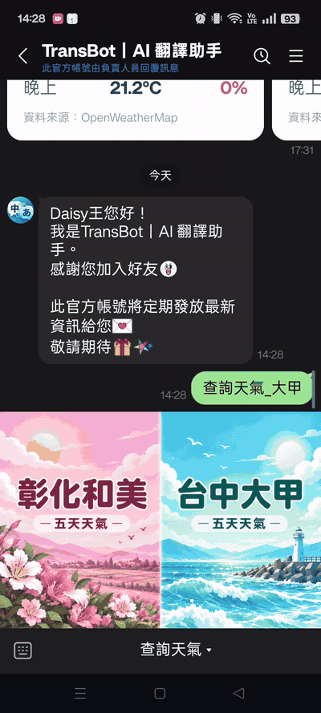
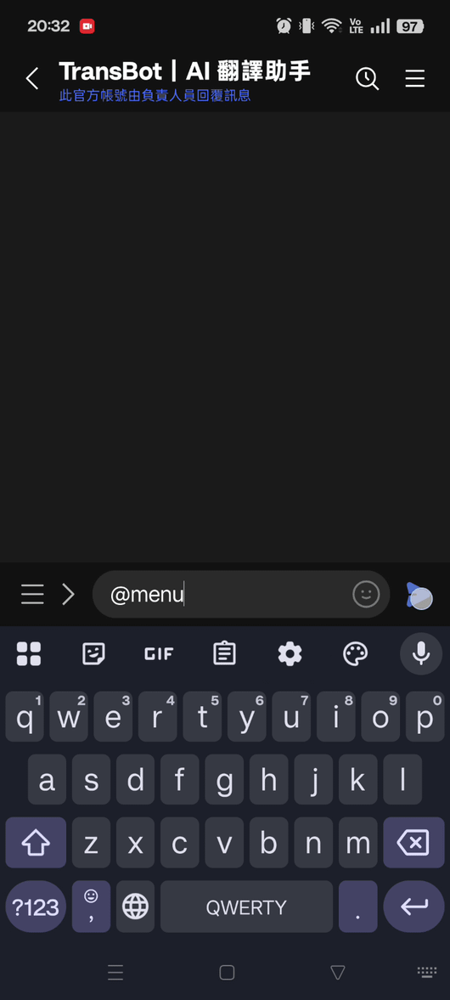

# n8n Workflow Portfolio

使用 n8n、JavaScript、REST API、Webhook 等技術，實作跨平台資料整合、自動化處理與 LINE 應用服務。 
本 Repository 提供各專案的 **n8n Workflow JSON**，完整的系統架構、功能展示、技術實作與問題排查紀錄請參考 Notion 作品集。 
📖 **[查看完整 Notion 作品集](https://ordinary-dahlia-9b9.notion.site/AI-Workflow-Portfolio-3a264eab269080c4ac68e3b91c984c7e)**

## Projects

### 1. LINE 天氣查詢與資料自動更新系統
整合 OpenWeather API、Google Sheets 與 LINE Messaging API，實現每日天氣資料自動更新及 LINE 即時天氣查詢。 
**Tech Stack:** n8n、JavaScript、OpenWeather API、Google Sheets API、LINE Messaging API、Webhook、HMAC-SHA256 
- [天氣資料自動更新 Workflow](./OpenWeather_to_Google_Sheets.json)
- [LINE 天氣查詢 Workflow](./LINE_Weather_Query.json)
- [詳細專案說明（Notion）](https://ordinary-dahlia-9b9.notion.site/LINE-n8n-Workflow-41864eab26908038935ac1b0c03b5108)

### 2. LINE 多國語言自動翻譯機器人
整合 LINE Messaging API 與 Google Cloud Translation API，支援八種目標語言翻譯、個人語言偏好保存與異常處理。 
**Tech Stack:** n8n、JavaScript、LINE Messaging API、Google Cloud Translation API、Webhook、Data Table、Flex Message、Quick Reply 
- [LINE 自動翻譯 Workflow](./LINE_Translator_Bot.json)
- [詳細專案說明（Notion）](https://ordinary-dahlia-9b9.notion.site/LINE-n8n-Workflow-41864eab26908038935ac1b0c03b5108)

## Usage
本 Repository 提供已移除個人環境識別資訊的 n8n Workflow JSON。 
可下載 JSON 並匯入 n8n 查看流程設計。實際執行前，需自行設定 API Credentials、Webhook 及相關外部服務資源。
